# Как настройки плоттера меняют путь ножа

Окно настроек: **Grbl → Плоттер...**

Здесь разобрано, что делает каждое поле. Речь про путь, который получится на резине и который вы увидите в окне программы. Скорость и паузы в конце отдельно: они линию не двигают.

На станке, под который сделаны значения по умолчанию, оси Z нет. Высоту ножа вы выставляете рукой до пуска. В файле остаются только X и Y, и каждое такое движение — рез.

## Две линии, которые легко перепутать

Станок возит **ось** поворотного ножа. Остриё отстаёт от оси на величину «Смещение лезвия».

- Синяя линия на рисунках — рисунок. По ней едет остриё, её и видит резина.
- Оранжевая линия — путь оси. Именно её показывает LaserGRBL.

На прямой они лежат на одной линии, но оранжевая длиннее: ось всегда впереди острия. На остром углу остриё стоит, а ось описывает дугу.

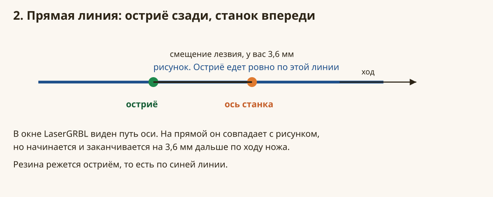

## С чего начинается любой файл

Перед пуском наведите позиционный лазер на левый нижний угол листа и нажмите обнуление XY.

Ноль станка в этот момент — ось лезвия, а не пятно лазера. По умолчанию лазер стоит на 10 мм правее лезвия и на одной с ним высоте по Y. Угол листа после обнуления имеет координату X+10, Y0.

Программа сдвигает рисунок так, чтобы левый нижний угол **габарита файла** попал в пятно лазера. Потом нож едет на парковку и только оттуда — к первому контуру.

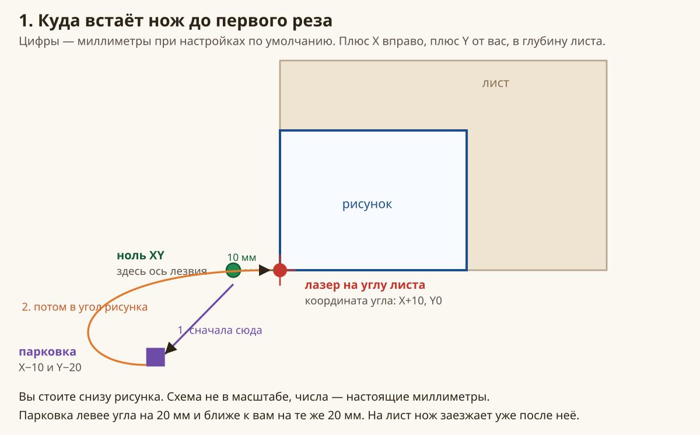

Парковка считается так:

- угол рисунка = (смещение лазера X, смещение лазера Y)
- парковка = (смещение лазера X − отступ, смещение лазера Y − отступ)

Отступ по умолчанию 20 мм. Парковка получается X−10, Y−20: на 20 мм левее угла и на 20 мм ближе к вам. Одно и то же число отступа вычитается и из X, и из Y. Отдельной ручки «только влево» или «только вниз» нет. Парковка всегда по диагонали: левее угла и ближе к вам на одно и то же расстояние.

Плюс X — вправо. Плюс Y — от вас, в глубину листа. Вы на рисунках стоите снизу.

### Что будет, если покрутить эти три числа

**Отступ 20, лазер X = 10, лазер Y = 0.** Это рисунок выше. Нож сначала уходит с нуля на парковку за пределы листа, потом врезается в угол рисунка.

**Отступ больше.** Парковка уезжает дальше влево и ближе к вам. Подъезд длиннее. Сам рисунок на листе не двигается: его угол по-прежнему под лазером.

**Отступ 0, лазер X и Y тоже 0.** Сдвига и парковки нет. Нож начинает с нуля XY как он есть. Если ноль попал внутрь рисунка, первый рез идёт от нуля до контура по короткой прямой и может разрезать деталь.

**Отступ 0, лазер X = 10.** Рисунок всё равно встаёт углом в точку лазера, а парковка совпадает с этим углом. Нож начинает прямо с угла габарита, запаса снаружи нет.

**Лазер стоит слева от лезвия, а не справа.** В «Смещение позиционного лазера X» поставьте минус, например −10. Плюс по X значит «лазер правее лезвия». Минус — «лазер левее». То же самое с Y: плюс — лазер дальше от вас, чем лезвие.

**Лазер Y не ноль.** Угол рисунка поднимается или опускается вместе с этим числом. Парковка остаётся на «отступ» миллиметров левее и ближе к вам от нового угла.

Отступ больше 500 мм программа обрежет до 500. Смещение лазера обрежется до диапазона от −500 до +500.

## Смещение лезвия

Поле «Смещение лезвия, мм». По умолчанию 3,60. Допустимо от 0 до 20.

Это расстояние от оси держателя до острия. Его вы измеряете на своём ноже.

На прямой ось едет по той же линии, что и остриё, но впереди на это расстояние. В окне программы линия поэтому чуть длиннее рисунка спереди.

На повороте от этого числа зависит радиус дуги: ось крутится вокруг острия по окружности этого радиуса. Смещение 3,6 мм даёт дугу радиусом 3,6 мм. Смещение 0,5 мм даёт маленькую дугу. Смещение 0 убирает дуги совсем: путь оси совпадает с рисунком. Так устроен пресет «Перо».

Чем больше смещение, тем шире оранжевый сектор на углу. Этот сектор тоже прорезается, потому что лезвие — палочка от оси до острия.

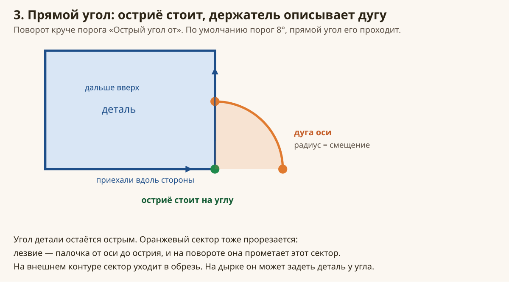

На внешнем контуре сектор уходит в обрезь, угол детали остаётся острым. На дырке тот же сектор лежит в материале детали и может задеть её рядом с углом. Большое смещение на дырке оставляет более заметный след.

## Острый угол и скругление

Поле «Острый угол от, град». По умолчанию 8. Допустимо от 0 до 180.

На прямой, на дуге и на скруглении ось идёт впереди острия по касательной. Смещение лезвия при этом есть, но контур не ломается на ступеньки. Так происходит при любом пороге и при любом смещении, кроме нуля: ноль просто выключает компенсацию, и ось едет по самому рисунку.

Дуга разворота ставится только на отдельный острый угол. Это одна точка между сторонами, поворот не меньше порога, и соседние точки так же не гнутся. Скругление и дуга в файле — цепочка похожих поворотов в одну сторону. Даже если каждый шажок цепочки больше порога, дуги разворота там нет: лезвие едет за осью.

- Отдельный угол круче порога, и смещение больше нуля: остриё стоит на углу, ось идёт дугой. Угол детали острый.
- Дуга, скругление или поворот слабее порога: дуги разворота нет. Ось повторяет кривую со смещением вперёд.

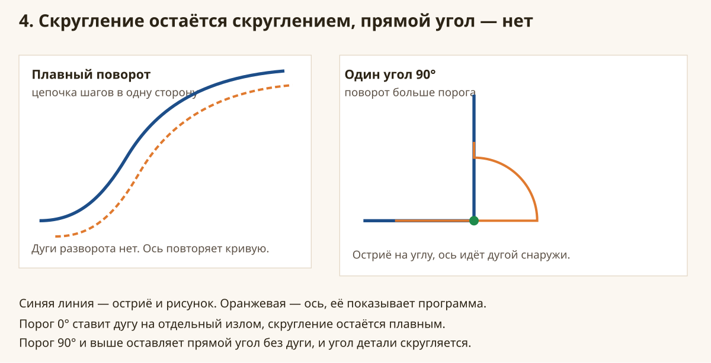

Прямой угол — это одна точка, где направление меняется сразу на 90°. Соседние точки так не поворачивают, 90 больше 8, поэтому там дуга.

**Порог 0.** Дуга появляется на каждом отдельном изломе. Дуга и скругление по-прежнему идут плавно, без ступенек.

**Порог 8, как сейчас.** Мелкий одиночный излом игнорируется. Углы квадрата и букв получают дугу. Скругления остаются гладкими.

**Порог 45.** Отдельный угол около 30° идёт как кривая, угол детали там слегка скругляется. Угол 90° по-прежнему с дугой.

**Порог 90 и выше.** Прямой угол уже не считается острым. Дуги разворота нет: ось проходит по биссектрисе, угол детали выходит скруглённым. Радиус этого скругления близок к смещению лезвия.

**Порог 180.** Дуга остаётся только на развороте почти назад.

Порог сравнивается с поворотом **после** упрощения пути. Если упрощение схлопнуло скругление в один острый угол, дуга появится, хотя на исходной картинке угол был круглым.

## Заход

Поле «Заход для разворота, мм». По умолчанию 3,60, как смещение. Допустимо от 0 до 50.

Заход — это кусок пути до рисунка, на котором остриё уже едет в нужную сторону. К началу контура лезвие подходит выровненным, а не боком.

При заходе, равном смещению, остриё начинает заход за 3,6 мм до первой точки рисунка и приходит в неё уже по курсу. Этот кусок тоже режется: нож в резине.

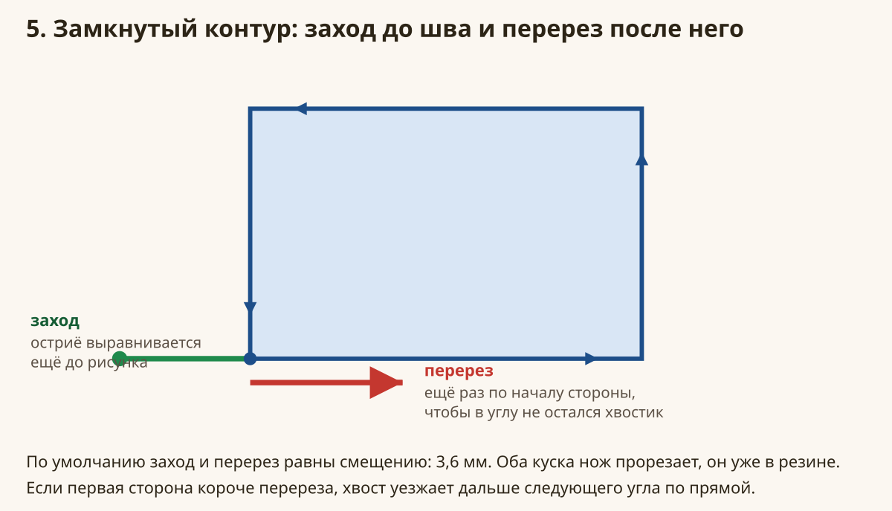

Если вход попал в угол, заход лежит на продолжении первой стороны **назад**, то есть снаружи контура. Если вход попал на середину стороны, заход лежит на самой стороне и просто проходит её кусок ещё раз.

**Заход 0.** Выравнивания нет. Ось сразу встаёт в рабочую точку. Первые миллиметры контура нож может пройти ещё повёрнутым поперёк, и линия получится рваной.

**Заход больше смещения.** Остриё начинает ещё дальше до рисунка. На короткой детали длинный заход уезжает далеко за габарит и режет пустое поле.

**Заход меньше смещения.** Выравнивание короче. Лезвие может не успеть довернуться до первой точки.

Имеет смысл держать заход равным смещению, если нет причины сделать иначе.

## Перерез

Поле «Перерез (overcut), мм». По умолчанию 3,60. Допустимо от 0 до 50.

На замкнутом контуре нож, обойдя фигуру, проходит начало первой стороны ещё раз на длину перереза. Так закрывается шов: в точке старта не остаётся неразрезанного хвостика.

На открытой линии перерез продолжает линию за конец, в ту же сторону. В начало нож не возвращается.

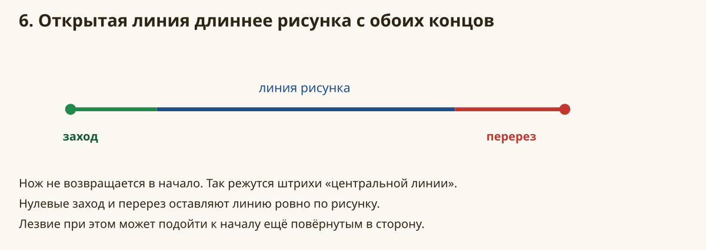

**Перерез 0.** Контур заканчивается ровно в точке рисунка. На замкнутой фигуре в шве часто остаётся тонкий недорез, потому что лезвие в момент прихода ещё доворачивалось.

**Перерез около смещения.** Шов закрывается, хвост короткий.

**Перерез длиннее первой стороны.** Хвост не останавливается на следующем углу. Он едет дальше по прямой в направлении первой стороны и может уйти внутрь детали или в обрезь. На узкой прорези короче 3,6 мм перерез 3,6 мм вылезает за неё.

## Одна фигура

Даже если в файле один контур, в режиме «Высота вручную» программа сама выбирает, с какой точки его начать.

Берётся ближайшая точка контура, до которой прямая от ножа не заходит внутрь фигуры. На квадрате, когда нож стоит снаружи у левого нижнего угла, вход будет у этого угла, а не в дальней точке, которую когда-то записал векторизатор.

Пробуются оба направления обхода. Побеждает то, у которого короче подъезд. Если подъезды одинаковые, остаётся направление из файла.

Поэтому первый рез не идёт через середину контура к случайной стартовой точке.

## Какой контур следующий

Поле «Оптимизация». Четыре способа. Пока нож не поднимается, во всех четырёх переезд обходит замкнутые контуры. Прямая сквозь фигуру остаётся только мостиком в дырку, до которой снаружи никак не добраться. Если нож поднимается — ось Z, серво или соленоид — переезд идёт по прямой поверх фигур: лезвие в этот момент не в материале.

**До ближайшего контура.** Из фигур, до которых можно доехать, не пересекая другую, берётся ближайшая к ножу. С парковки это обычно угол листа, который ближе всех.

**Снаружи внутрь.** Сначала фигуры, которые стоят у края листа, потом те, что ближе к середине. Ближний центральный контур не перескакивает очередь, пока по краю ещё есть фигура с свободным подъездом.

**Изнутри наружу.** Если до отверстия уже есть свободный подъезд, оно идёт раньше рамки. Дырка внутри замкнутой рамки снаружи недоступна, поэтому рамка всё равно первая, а потом короткая перемычка в дырку.

**Как в файле.** Порядок контуров не меняется. Точку входа программа всё равно ставит на ближайшую внешнюю точку, а переезд обводит чужие контуры.

Открытая линия препятствием не считается. Через штрих нож может пройти.

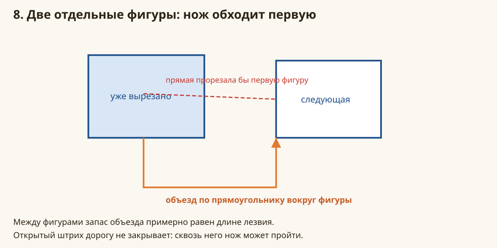

Щель между фигурами нож использует, даже если она уже, чем смещение лезвия. Объезд идёт вплотную к контуру, а не большим прямоугольником, который эту щель закрывал бы. Если деталей много, нож не режет их по прямой только потому, что прямоугольники вокруг габаритов не сложились в дорогу.

## Рамка и дырка

Пока нож не поднимается, дырка внутри замкнутой рамки снаружи недоступна: любая прямая в неё пересекает рамку. Нож сначала вырезает рамку. Потом коротко режет перемычку от рамки к дырке и обходит дырку. Так делают все четыре способа оптимизации: свободного подъезда к дырке нет, пока нож снаружи. Если нож поднимается, «Изнутри наружу» может начать с дырки: переезд к ней идёт с поднятым лезвием и резину не режет.

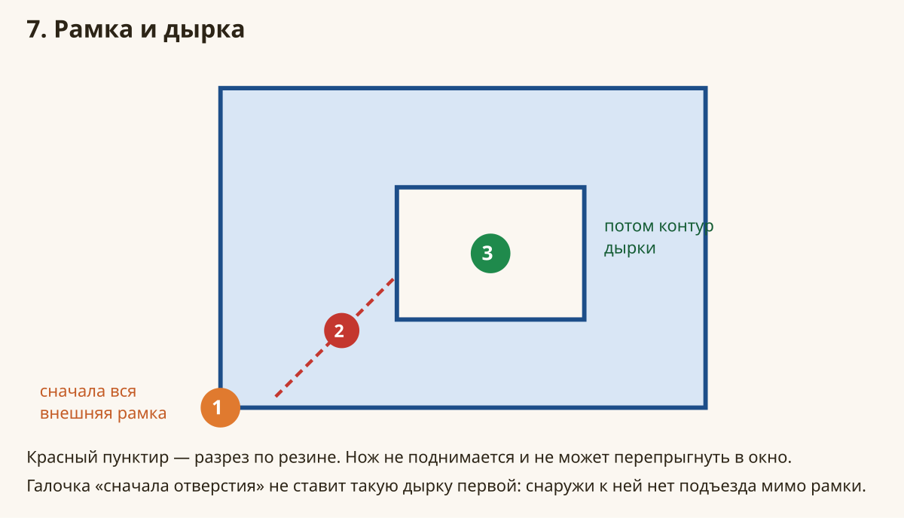

«Изнутри наружу» меняет порядок там, где до внутреннего контура уже есть прямая, которая не заходит внутрь другого замкнутого контура. На обычном квадрате с окном и на букве «О» при старте снаружи этого нет.

## Упрощение и минимальный отрезок

Оба поля работают **до** смещения лезвия. Они меняют сам рисунок. Дуга и перерез потом строятся уже по упрощённой линии.

«Упрощение пути, мм» — допуск. Точка, которая отклоняется от прямой меньше этого допуска, выбрасывается. По умолчанию 0,05 мм. Допустимо от 0 до 5.

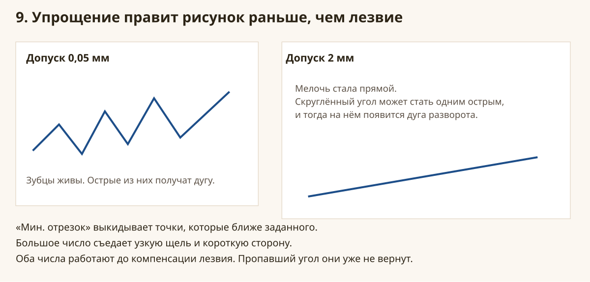

**0.** Остаются почти все точки файла. Шум векторизации тоже остаётся и может дать лишние мелкие дуги на углах.

**0,05.** Уходит дрожание линии. Углы и скругления, которые видны глазом, остаются.

**0,5 и больше.** Пропадают мелкие зубцы, узкие выступы, надписи. Скруглённый угол может превратиться в один острый, и тогда на нём появится дуга разворота, хотя на картинке угол был круглым.

**5.** От рисунка остаётся грубый многоугольник.

«Мин. отрезок, мм» применяется следом. По умолчанию 0,02 мм. Точки ближе этого расстояния к предыдущей выбрасываются. Конец линии сохраняется: пропадает точка перед ним, а не сам конец.

**Большой минимальный отрезок**, например 2 мм на детали с щелью 1 мм. Щель схлопывается, короткая сторона пропадает, угол переезжает.

Есть ещё одно правило без ручки. Если концы линии ближе друг к другу чем на 0,2 мм, программа считает контур замкнутым: появятся обход по кругу и перерез шва. Линия, у которой концы разведены сильнее, остаётся открытой.

## Проходы

Поле «Проходы». По умолчанию 1. Допустимо от 1 до 30.

Каждый контур повторяется указанное число раз, и только потом нож переходит к следующему. Это не «сначала все фигуры, потом всё заново».

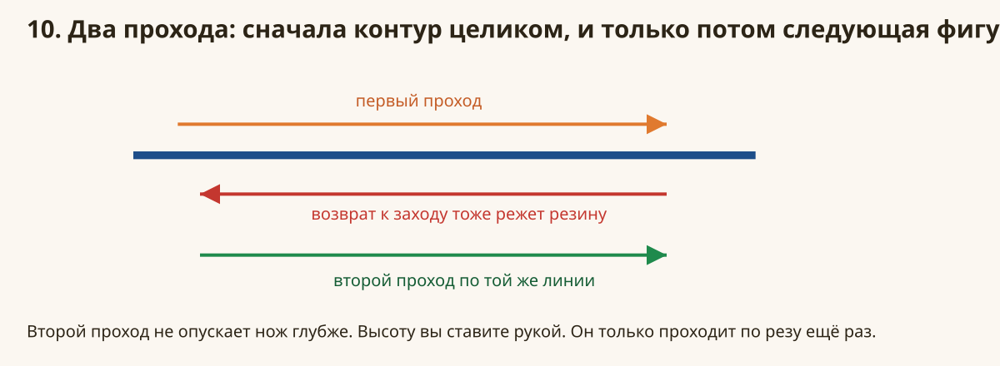

Между повторами нож возвращается от конца перереза к началу захода. В ручном режиме этот возврат тоже режет резину. Обычно он идёт вдоль той же линии.

Второй проход не заглубляет нож. Высота как была выставлена рукой. Второй проход имеет смысл, если первый не прорезал резину насквозь.

В настройках Grbl есть отдельное поле «Между проходами». Это проходы **всего файла** LaserGRBL, другая вещь. Число в окне плоттера крутит повторы внутри одного контура.

## Высота вручную и нож с подъёмом

Поле «Подъём / опускание ножа». Для вашего станка — «Высота вручную, только X и Y».

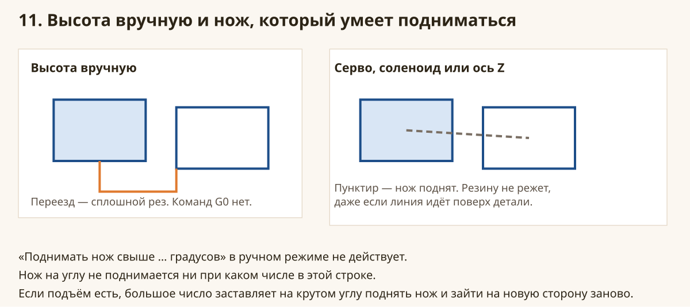

**Высота вручную.** В файле нет M3, M5 и движений Z. Любой переезд записывается как G1. Быстрого хода G0 по X и Y плоттер не пишет. Нож не поднимается ни на переезде, ни на углу. Поле «Поднимать нож свыше, град» в этом режиме не читается, что бы там ни стояло.

**Серво на ШИМ (M3 S).** На переезде нож поднимается командой M3 со значением «S, нож вверх», опускается значением «S, нож вниз». Пока нож поднят, прямая может идти поверх детали и резину не режет. При скорости переезда 0 этот ход будет G0.

**Соленоид.** Вниз — M3, вверх — M5. Число S вниз берётся из «S, нож вниз», а если там 0, подставляется 255.

**Ось Z, стандартный подъём.** Лезвие закреплено на оси Z, шаговик сам поднимает и опускает её. Вверх — быстрый ход `G0` на «Z вверх». Вниз — рабочий ход `G1` на «Z вниз» со скоростью опускания. Пока нож поднят, переезд — прямая поверх контуров, а не объезд. «Изнутри наружу» при этом может начать с дырки.

**Ось Z, кулачок.** Двигатель оси Z повёрнут на 90°, на валу кулачок. Поле «Нажим кулачка» — команда Z, поворот на которую толкает голову вниз на длину кулачка. Поле «Отпуск кулачка» — команда Z, при которой кулачок отпускает голову, и пружины поднимают лезвие. Оба хода пишутся как `G1` со скоростью опускания, без быстрого `G0` по Z. Путь по XY считается так же, как у стандартной оси: нож на переезде поднят, поэтому прямая может идти поверх фигур. Числа «Z вверх» и «Z вниз» в режиме кулачка не используются.

Поле «Поднимать нож свыше, град» работает только когда нож умеет подниматься, включая оба режима оси Z. 0 значит «на углу не поднимать». Если поворот круче этого угла, дуги вокруг острия нет: нож поднимается, переезжает на заход новой стороны и опускается. Угол не прометается сектором.

Скорость опускания, пауза после опускания и пауза после подъёма тоже относятся к режимам с подъёмом. Пауза пишется как G4 и даёт серво или соленоиду время доехать. На форму линии XY они не влияют. В ручном режиме эти поля в файл не попадают.

## Скорости

**Скорость реза** ставится на резы контура, заход, дугу и перерез. По умолчанию 600 мм/мин. Форму линии не меняет. Если в окне импорта картинки или SVG задана скорость контура больше нуля, она подменяет скорость плоттера и запоминается: следующее открытие файла уже поедет с новой скоростью.

**Переезд.** Это скорость подъезда, объезда и перехода между фигурами.

- Ручной режим, переезд 0. Переход едет со скоростью реза. Всё равно G1, всё равно режет.
- Ручной режим, переезд 200. Контур едет с скоростью реза, а переход между фигурами — медленнее, на 200. Линия та же, меняется только подача. Медленный переход меньше рвёт резину на перемычке.
- Режим с подъёмом, переезд 0. Переход — быстрый ход G0, нож поднят.
- Режим с подъёмом, переезд больше 0. Переход — G1 с этой подачей, нож поднят.

Скорость реза меньше 1 программа поднимет до 1. Больше 50000 обрежет.

## Дуги в виде отрезков

Галочка «Заменять дуги поворота короткими отрезками» выключена по умолчанию.

Выключена: поворот пишется дугой G2 или G3. Включена: та же дуга режется короткими прямыми с шагом 10°. Форма угла почти та же. Галочка нужна, если контроллер плохо едет по дугам. Шаг 10° в окне отдельно не выставляется.

## Пресет и имя лезвия

Пресет подставляет три числа и имя:

| Пресет | Смещение | Перерез | Заход |
| --- | --- | --- | --- |
| Резина, лезвие 3,60 мм | 3,60 | 3,60 | 3,60 |
| Перо | 0 | 0 | 0 |
| Винил 0,25 мм | 0,25 | 0,50 | 0,25 |
| Канцелярское 0,50 мм | 0,50 | 1,00 | 0,50 |
| Глубокое 0,75 мм | 0,75 | 1,20 | 0,75 |

Пресет не трогает отступ, лазер, скорости, режим ножа и порог угла.

Если после пресета поменять смещение, перерез или заход руками, пресет становится «Своё». Обратно на «Резина» эти три числа снова встанут в 3,60.

Имя лезвия пишется комментарием в начале файла. На путь не влияет.

## Когда программа вообще строит этот путь

Галочка «Режим плоттера при импорте изображений, SVG и DXF».

**Включена.** Картинка в режиме векторизации даёт контуры и дырки. Центральная линия даёт штрихи. SVG и DXF проходят через нож: заход, дуги, парковка. Штриховка в окне картинки при этом погашена, заливка квадрата зигзагом не строится. Растр и дизеринг выбрать нельзя.

**Выключена.** Импорт идёт как у обычного LaserGRBL. DXF в этом случае пишется с быстрыми ходами G0 и командами лазера M3. Парковки и компенсации лезвия нет.

Обычный файл G-code сам по себе не пересчитывается. Для уже открытого файла есть пункт **Файл → Применить плоттер к загруженному файлу**. Он строит путь по текущим настройкам плоттера.

Второй раз на тот же файл этот пункт запускать не надо. Программа примет уже сдвинутый путь оси за новый рисунок и сдвинет его ещё раз. Углы раздуются, размер уедет. Если нужно пересчитать, откройте исходный файл заново и примените один раз.

## Конец работы, которого нет в настройках плоттера

В настройках Grbl есть блок «После окончания». Туда по умолчанию записано `G0 X0 Y0 Z0`. LaserGRBL отправляет эту строку, когда работа заканчивается. При сохранении файла та же строка попадает в файл, если включён экспорт окончания.

Это быстрый ход в ноль. Плоттер его не строит и не обводит вокруг контуров. Нож в ручном режиме к этому моменту всё ещё опущен, поэтому ход домой прорежет резину по прямой к нулю. Если такой ход не нужен, очистите поле «После окончания».

## Если на резине не то, что ждали

| Что получилось | Что крутить |
| --- | --- |
| Первый рез идёт через середину детали | Режим «Высота вручную». Отступ больше нуля. Откройте файл заново, не применяйте плоттер второй раз |
| Нож стартует на листе, а не снаружи | Отступ. При 20 мм парковка левее угла и ближе к вам |
| Парковка не с той стороны | Знак смещения лазера X или Y. Плюс X — лазер правее лезвия |
| Углы детали круглые | Уменьшите «Острый угол от». Проверьте, что смещение не 0 |
| На гладкой кривой нож дёргается дугами | Уменьшите упрощение: скругление не должно схлопнуться в один угол |
| В шве остался хвостик | Увеличьте перерез примерно до смещения |
| Перерез вылезает за короткую сторону | Уменьшите перерез, чтобы он был короче этой стороны |
| Пропали зубцы, щели, мелкая надпись | Уменьшите упрощение и минимальный отрезок |
| Между рамкой и дыркой есть разрез | Так и будет, пока нож не поднимается. Это переход внутрь |
| У дырки угол детали подрезан сектором | Это дуга смещения. Меньшее смещение даёт меньший сектор |
| Второй проход едет назад по той же линии | Поле «Проходы». Поставьте 1, если повторять не нужно |
| В файле есть G0 в середине | Режим не «Высота вручную», либо плоттер был выключен при импорте DXF |
| В конце нож быстро едет в ноль | Поле «После окончания» в настройках Grbl, не в окне плоттера |
| Размер поехал после повторного «Применить плоттер» | Откройте исходный файл и примените один раз |

## Все поля окна по одной строке

- **Режим плоттера при импорте.** Включает пересчёт картинок, SVG и DXF. На уже открытый G-code само не действует.
- **Пресет лезвия.** Подставляет имя, смещение, перерез и заход.
- **Имя лезвия.** Только комментарий в файле.
- **Смещение лезвия.** Насколько ось впереди острия. Радиус дуги на остром углу.
- **Перерез.** Насколько остриё заходит за шов замкнутого контура или за конец открытой линии.
- **Заход.** Насколько остриё выравнивается до первой точки рисунка.
- **Острый угол от.** С какого поворота включать дугу. Меньше число — больше дуг.
- **Поднимать нож свыше.** В ручном режиме не действует. С подъёмом — с какого угла поднимать нож вместо дуги.
- **Упрощение пути.** Какие мелкие изломы стереть до компенсации лезвия.
- **Мин. отрезок.** Какие слишком короткие куски стереть следом.
- **Проходы.** Сколько раз повторить каждый контур, прежде чем идти к следующему.
- **Отступ снаружи габарита.** Насколько парковка левее и ближе к вам, чем угол рисунка. Одно число на обе оси.
- **Смещение лазера X.** Насколько лазер правее лезвия. Столько же прибавляется к X угла рисунка.
- **Смещение лазера Y.** Насколько лазер дальше от вас, чем лезвие.
- **Скорость реза.** Подача на контуре, заходе, дуге и перерезе. Форму не меняет.
- **Переезд.** Подача перехода между фигурами. В ручном режиме переход всё равно G1, всё равно режет и идёт в обход. С подъёмом 0 значит быстрый G0 поверх фигур.
- **Скорость опускания.** Только для оси Z.
- **Пауза после опускания и после подъёма.** Только когда нож умеет подниматься.
- **Нож.** Ручная высота — нож всегда внизу, путь в обход. Ось Z, серво и соленоид поднимают нож, путь между контурами прямой.
- **Подъём Z.** Только для оси Z. Стандартный — шаговик двигает лезвие. Кулачок — поворот толкает голову вниз, пружины поднимают.
- **S вверх и S вниз.** Команды серво или соленоида.
- **Z вверх и Z вниз.** Куда ехать по Z в стандартном режиме.
- **Отпуск кулачка и нажим кулачка.** Команды Z для кулачка: отпуск поднимает пружинами, нажим опускает голову на длину кулачка.
- **Оптимизация.** Какой контур следующий. Без подъёма переезд обходит замкнутые контуры. С подъёмом идёт по прямой.
- **Заменять дуги короткими отрезками.** Те же углы, но серией прямых через 10° вместо G2/G3.
